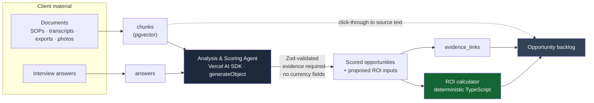

# Vedette

**AI opportunity assessment where every claim traces to source text, and no dollar figure is ever written by a language model.**

🔗 **[Live demo →](https://vedette-lilac.vercel.app/opportunities)** · no login, no setup

A *vedette* is a mounted sentry posted forward of an army's lines — the furthest-deployed set of eyes, whose job is to see what the force behind cannot and report back what's true. The product does the same for an organisation.

Built by a working AI consultant to run real client engagements. **v1.0 "Kestrel."**

---

## The 30-second version

An executive asks one question about any AI recommendation: **"how do you know that?"** Most AI-generated assessments fail it twice — the reasoning can't be cited, and the dollar figures were produced by the same system that produced the enthusiasm.

Vedette answers both, and enforces the answers in code:

| | |
|---|---|
| **Every score opens to its source text.** | Click a score → read the rationale → click a source chip → read the exact sentence it came from. A claim that cites nothing must declare itself an assumption, or the model's output fails schema validation and is retried. |
| **The model cannot state a dollar amount.** | Its output schema has no currency field for any benefit. It proposes hours, headcount, and durations; [`src/lib/roi/model.ts`](src/lib/roi/model.ts) computes the money, deterministically, pinned by 21 tests. |
| **Assumptions are never dressed as facts.** | Anything inferred rather than found is flagged amber and stays editable. Change one and every figure recalculates instantly. |
| **It declines to flatter.** | Three of the seven opportunities in the demo never pay back inside 36 months. That output is committed unedited. |

---

## The demo: Meridian Field Services

> **Meridian is fictional.** A ~400-person commercial facilities-maintenance company, invented for this demo and internally consistent across every document. It is **not** a real customer, and none of its documents, people, or figures describe one.

It was built to look like an engagement an FDE actually walks into, not a clean dataset:

- **ServiceTitan adopted but only partly configured**, NetSuite for finance, and a decade of process living in shared-drive spreadsheets.
- **Two regions acquired in 2024** still running a prior scheduling tool.
- **Documents that disagree with each other.** The SOP says work orders above $2,500 need three approvals; the dispatch team's working notes say the third "stopped happening months ago" and nobody updated the SOP. The agent noticed, and one opportunity is specifically about that gap.
- **A whiteboard photo** cited as evidence alongside PDFs and CSV exports.
- **A payroll export that was requested and never arrived** — so loaded hourly cost is unestablished, and that appears in the UI as an open coverage gap rather than being quietly guessed.

The committed analysis is a real `claude-opus-5` run over 26 chunks: **7 opportunities, 56 dimension scores, 110 evidence links, 13 coverage gaps**, citing **all 26** available chunks, with 13 of 56 scores self-flagged as assumptions.

---

## Architecture



**Stack:** Next.js (App Router) · TypeScript · Tailwind + shadcn/ui · Supabase (Postgres, pgvector, RLS) · Vercel AI SDK · Vercel.

---

## The trust boundary

This is the design decision the product is built around.

| The **model** does | **Code** does |
|---|---|
| Proposes candidate opportunities | Performs every financial calculation |
| Proposes ROI *inputs* — hours, headcount, automation share, adoption, ramp | Recalculates instantly when any input changes |
| Scores 8 dimensions against evidence, with rationale and confidence | Computes the weighted composite and the ranking |
| Declares what it could not determine | **Never accepts a model-authored dollar figure** |

Two mechanisms enforce it rather than merely describing it:

**1. There is no field for a dollar amount.** The agent's Zod schema exposes counts, rates, and durations only. It cannot inflate a headline because there is nowhere to write one.

**2. The rate is not the model's to name.** Loaded hourly cost is the highest-leverage number in any savings calculation. The agent proposes a role *band* (`frontline_admin`, `field_technician`, …) and the application looks up the rate from [`src/lib/roi/defaults.ts`](src/lib/roi/defaults.ts). A plausible-looking hourly figure is exactly the kind of thing no reviewer would question — so the model never supplies one.

```ts
// src/lib/ai/schemas/opportunity.ts — a claim must cite evidence or admit it is an assumption
if (!val.isAssumption && val.evidenceIds.length === 0) {
  ctx.addIssue({ code: "custom", message:
    "A non-assumption must cite at least one evidence id. Either cite the chunk " +
    "you used, or set isAssumption to true." });
}
```

Because this runs at the `generateObject` boundary, a violation is a **model retry**, not a bug that reaches the UI.

### Why deterministic, and not "just ask the model for the number"

A number an executive will be held to has to be reproducible, auditable, and arguable. A model-generated figure is none of those: it can't be re-derived, its sensitivity to any single assumption is invisible, and a client who disputes it has nothing to push against. A pure function has all three — the demo lets you drop adoption from 85% to 40% and watch the case change, which is the conversation an FDE is actually there to have.

### Why assumptions are explicit

The fastest way to lose a room is to present an inference as a finding and have someone in it know better. Every value carries `isAssumption` separately from its source, because a model-proposed value grounded in a quoted SOP is a *finding*, while the same field guessed from industry norms is an *assumption* — the UI must render those differently, so the distinction cannot be collapsed into one flag.

---

## The data model

The schema is where engagement experience shows most.

[`supabase/migrations/0001_init.sql`](supabase/migrations/0001_init.sql) — **18 tables**, multi-tenant by `organization_id`, **default-deny RLS on every table**, pgvector at 1536 dimensions with a cosine HNSW index. Applied and verified on a live Supabase project.

The v1.0 draft was walked against a real discovery engagement. It held for the core spine and broke in five specific places. None of these are features; each is a thing that happens on every engagement and appears in no textbook data model:

| What actually happens | What the schema had to become |
|---|---|
| A stakeholder tells you something, then **corrects it by email two days later**. Both are true at different times, and the agent must prefer the later one without losing the earlier. | `answers.status` (active/superseded/retracted) + self-referencing `superseded_by_answer_id` |
| Discovery asks for a document that **does not exist yet** — and the fact that it's missing is itself a finding worth tracking. | Document lifecycle `requested → received → processing → processed`; a `requested` row has no file, so `storage_path` and `file_name` had to become nullable |
| Half of what matters is **a photo of a whiteboard**, not a PDF. | Media `doc_type`s + `extraction_status`; vision output becomes chunks, so evidence links work identically for images and text |
| The brief gets **revised after review**, and v1 must survive. | `version` + `supersedes_deliverable_id` |
| Interviews are **group sessions**, not 1:1s. | `interview_participants` junction replaced the 1:1 stakeholder link |

The demo exercises all five — including the unreceived payroll export, whose absence is visible in the UI as a coverage gap, and a whiteboard photo cited as evidence.

**Evidence architecture:** `evidence_links` is a polymorphic join from any claim (`score`, `roi_model`, `opportunity`, …) to any source (`chunk` or `answer`), with a trigger enforcing that the source exists *within the same tenant and engagement* — so a citation can never cross a tenant boundary even by accident. The seed loader threads chunk ids through to database UUIDs and aborts the whole load on a dangling citation, because an evidence drawer that opens on nothing is worse than no evidence drawer.

**RLS is proven, not asserted.** [`tests/rls.test.ts`](tests/rls.test.ts) connects as the same `authenticated` role a browser client uses, with no org claim, and asserts it sees zero rows — with the seeded engagement actually present in the tables. It also asserts that role can *execute* the tenancy helpers: a policy that cannot call its own helper fails closed, which is indistinguishable from correct isolation and would make the leak test pass for entirely the wrong reason.

---

## Key decisions

Every pinned choice has an ADR, including the rejections.

| ADR | Decision | Why it matters |
|---|---|---|
| [001](docs/adr/ADR-001.md) | Supabase client as the data layer, **no Prisma** | RLS is the security boundary. An ORM that abstracts the connection makes it easy to bypass the thing enforcing multi-tenancy. |
| [002](docs/adr/ADR-002.md) | Clerk for auth, org-scoped | The `org_id` claim is what RLS reads. Chosen before the schema, because retrofitting tenancy is the expensive kind of mistake. |
| [003](docs/adr/ADR-003.md) | Vercel AI SDK, **no LangGraph/LangSmith** | Orchestration here is sequential and legible — three agents, one critic loop. That's plain control flow, not a graph that needs a runtime. `generateObject` + Zod is what makes the evidence invariant enforceable at the type boundary. |
| [004](docs/adr/ADR-004.md) | **Three agents, not nine** | The single largest scoping decision. |
| [005](docs/adr/ADR-005.md) | OpenAI `text-embedding-3-small`, 1536 dims, cosine | Pins the vector dimension and index opclass so the schema stops churning. Voyage is the pre-vetted upgrade if Phase 2 dogfooding shows weak retrieval. |

### Why nine agents became three

The first design had a specialist agent per discovery area — an interviewer, a process mapper, a systems cataloguer, a pain-point extractor, a scorer, an ROI modeller, a writer, a critic, an orchestrator. It reads impressively on a diagram.

It was wrong for three reasons. **Most of those "agents" were prompts, not agents** — they had no independent tool access, no distinct control flow, and no reason to hold their own context; they were one model call with a different system prompt. **Every hop cost fidelity**: passing extracted entities between agents meant re-summarising, and evidence ids are exactly the kind of detail that gets dropped in a summary — the citation trail would have degraded at each boundary. And **nine agents is nine places for the evidence invariant to leak**; one schema boundary is auditable, nine are not.

What survived is three agents that genuinely differ in what they do and what they touch — **Discovery** (conversational, stateful, human-in-the-loop), **Analysis & Scoring** (batch, structured output, evidence-bound), **Executive Synthesis** (long-form generation with a critic pass) — and the rest became prompt perspectives inside them. Scoping down is part of the engineering, not a concession.

---

## What's real, what's seeded, what's deferred

Stated explicitly, because a portfolio piece that blurs this is worthless.

**✅ Real — working application behaviour**
- The `claude-opus-5` agent call, Zod-validated, provider-swappable ([`src/lib/ai/provider.ts`](src/lib/ai/provider.ts) is the only file naming a provider)
- The ROI engine — pure TypeScript, recalculating live in the browser
- The Supabase database — 18 tables, RLS enforced and tested against real rows
- Evidence click-through, from score to rationale to source text
- The scoring composite, ranking, and portfolio totals

**🟡 Seeded — fictional demo data**
- Meridian Field Services: the company, its 8 documents, 26 chunks, 5 stakeholders, and all operational figures
- The committed analysis snapshot: a *real* model run, over *invented* source material. Rendering a snapshot rather than calling the model per page-load keeps the demo free, fast, and incapable of failing mid-presentation. `npm run analyze` regenerates it.

**⏳ Deferred — specified, scheduled, not built**

| Surface | Phase |
|---|---|
| Document ingestion (upload, parse, chunk, embed) + entity browser | 2 |
| Adaptive discovery + interview tracker | 3 |
| Executive brief, critic pass, PDF export | 5 |
| Clerk auth wiring | deferred |

Unbuilt surfaces are labelled **"coming in Phase N"** in the app rather than faked. Chunk embeddings are deliberately `null` — seeding fake vectors would make retrieval look implemented when it isn't.

**On auth:** Clerk is specified and the RLS policies already assume its `org_id` claim, but the session plumbing isn't wired. Multi-tenancy lives in the data model, where retrofitting is expensive; session plumbing doesn't, where it isn't. Shipping the demo behind a login screen a week later would have cost more than it bought.

---

## Running it

```bash
git clone https://github.com/meekch/vedette.git
cd vedette && npm install && npm run dev     # → localhost:3000/opportunities
```

**The demo needs no environment variables and no database.** Keys are only for regenerating the analysis or loading the database.

```bash
npm test          # 39 tests
npm run typecheck
npm run lint
npm run build

npm run analyze   # regenerate the analysis with a real model call (needs ANTHROPIC_API_KEY)
npm run seed      # load Meridian into Supabase (needs DATABASE_URL); refuses to overwrite without --force
```

### Tests

```
tests/roi.test.ts     Arithmetic, ramp behaviour, payback, out-of-range guards
tests/seed.test.ts    Snapshot validates against the live agent schema; every cited
                      evidence id resolves; nothing cites an unreceived document;
                      no dollar figure appears in prose that isn't in the sources
tests/rls.test.ts     Zero-leak isolation + ROI rows reproduce from their own stored
                      inputs. Needs a database; skipped without DATABASE_URL
tests/smoke.test.ts   Navigation honesty — a surface is built or labelled
```

`tests/seed.test.ts` holds the demo data to exactly the contract the live agent is held to. If the snapshot could contain an uncited claim, the product would be asserting an invariant the code doesn't enforce.

### Environment

Copy `.env.example` → `.env.local`. Provider is auto-detected from whichever key is present.

| Variable | For |
|---|---|
| `ANTHROPIC_API_KEY` | `npm run analyze` (default provider) |
| `OPENAI_API_KEY` | alternative chat provider; embeddings from Phase 2 |
| `DATABASE_URL` | `npm run seed`, `tests/rls.test.ts` — use the **session pooler** (5432); the direct host is IPv6-only |

> **Adding a dependency on Windows?** Run `npm run lockfile:linux` afterwards (needs WSL). npm omits Linux-only optional deps (`@emnapi/*`, via the wasm fallbacks for `sharp` and `@tailwindcss/oxide`) from a Windows-generated lockfile, so `npm ci` fails on the CI runner while everything passes locally.

---

## Three-minute walkthrough

1. **[`/opportunities`](https://vedette-lilac.vercel.app/opportunities)** — seven scored opportunities, ranked. Read *How to read this page* first; it decodes the visual language in four lines.
2. **Click any score row** (e.g. *Impact* on the top opportunity). Rationale, weight, polarity — and the source chips. Click one: the exact text it came from.
3. **Open `dispatch process notes (working).docx`** in any evidence drawer. Flagged **unstructured source**, and it contradicts the SOP on approval steps. The agent caught the discrepancy and built an opportunity around it.
4. **Open the ROI model.** Left: what the model proposed. Right: what code computed. Amber dots mark assumptions.
5. **Find one that doesn't pay back.** Open *Self-serve work order status* — note implementation and run cost are both assumptions with no evidence, then drop the run cost. Payback appears. The tool didn't flatter the case, and deciding which assumption is load-bearing is the consultant's actual job.
6. **Scroll to the bottom.** Thirteen coverage gaps — including a loaded-cost figure that is unestablished because the payroll export was requested and never received.

> The numbers are deliberately un-tuned: the snapshot is whatever the model said, held to the evidence contract by tests and otherwise unedited — including where that makes the business case look weak.

---

## Roadmap

Phases 2–6 in [`docs/PHASES.md`](docs/PHASES.md), each with acceptance criteria and a dogfood checkpoint. Architecture: [`docs/architecture.md`](docs/architecture.md). Charter: [`docs/CHARTER.md`](docs/CHARTER.md). Decisions index: [`docs/DECISIONS.md`](docs/DECISIONS.md).

Documented but deliberately not built: scenario planning, external integrations (M365, Salesforce, Jira, ServiceNow), continuous-learning loop, pptx export, multi-engagement analytics.

Release codenames are birds of prey, beginning with **v1.0 "Kestrel"** — a falcon that hunts by perceiving ultraviolet trails invisible to human eyes.
