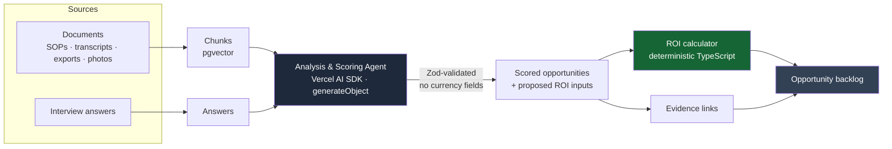

# Vedette

**AI transformation intelligence, where every claim traces to evidence and no number comes from a language model.**

A *vedette* is a mounted sentry posted forward of an army's lines — the furthest-deployed set of eyes, whose job is to see what the force behind cannot, and report back what's true. The product does the same for an organisation: it is deployed forward into their documents, workflows, and people, and reports back with evidence.

Built by a working AI consultant to run real client engagements. Dogfooding is a hard requirement; demo polish comes second.

> **Status:** Phase 1 of 6. The opportunity-scoring loop is fully implemented against a seeded engagement. Document ingestion, adaptive discovery, and executive deliverables are specified and scheduled, not built — see [What's built](#whats-built-and-what-isnt).

---

## The argument

Most AI-opportunity assessments are a language model's opinion, formatted. They fail the only question an executive actually asks — *how do you know that?* — and they fail it twice: the reasoning is unciteable, and the dollar figures were generated by the same system that generated the enthusiasm.

Vedette is built around two invariants that answer both.

### 1. Evidence or it doesn't render

Every score, every ROI input, every claim carries either a citation into source text or a visible **assumption** flag. There is no third state.

This is enforced mechanically, not by convention. The agent's output schema rejects any claim that cites no evidence while also declaring itself a finding:

```ts
// src/lib/ai/schemas/opportunity.ts
if (!val.isAssumption && val.evidenceIds.length === 0) {
  ctx.addIssue({ code: "custom", message:
    "A non-assumption must cite at least one evidence id. Either cite the chunk " +
    "you used, or set isAssumption to true." });
}
```

Because this runs at the `generateObject` boundary, a violation is a **model retry**, not a bug that reaches the UI. In the interface, every dimension score expands to its rationale and the quoted source text behind it.

### 2. The model proposes; TypeScript computes

The agent never emits a dollar figure — it has nowhere to put one. Its schema contains no currency field for any *benefit*. It proposes hours, headcount, rates, and durations; [`src/lib/roi/model.ts`](src/lib/roi/model.ts) turns those into money, deterministically, and [`tests/roi.test.ts`](tests/roi.test.ts) pins the arithmetic.

The loaded hourly rate — the single highest-leverage number in any savings calculation — is deliberately *not* something the agent can name. It proposes a role **band**; the application looks up the rate. If the model could state a rate, it could move the headline by stating a bigger one, and no reviewer would notice a plausible hourly figure.

The UI makes this seam visible rather than merely true: proposed inputs on the left, a labelled divider, computed outputs on the right. Every input is editable and the figures recompute instantly, because the calculator is a pure function.

---

## Architecture



Three agents, not nine — Discovery, Analysis & Scoring, Executive Synthesis, with a critic pass. Other "agent" roles that appear in comparable products are prompt perspectives inside these three. The reasoning is in [ADR-004](docs/adr/ADR-004.md); collapsing the agent count was the single largest scoping decision in the design.

**Stack:** Next.js (App Router) · TypeScript · Tailwind + shadcn/ui · Supabase (Postgres, pgvector, RLS) · Vercel AI SDK · Vercel. Each pinned choice has an ADR, including the rejections ([no Prisma](docs/adr/ADR-001.md), [no LangGraph](docs/adr/ADR-003.md)).

---

## The data model

The schema is the part of this repository that took the most thinking, and it is where the engagement experience actually shows.

[`supabase/migrations/0001_init.sql`](supabase/migrations/0001_init.sql) — 18 tables, multi-tenant by `organization_id`, default-deny RLS on every table, pgvector at 1536 dimensions with a cosine HNSW index ([ADR-005](docs/adr/ADR-005.md)). Applied and verified on a live Supabase project: RLS on all 18, 4 policies each (2–3 on the two tables with narrower rules), plus a private `documents` bucket with 4 storage policies.

The v1.0 draft was walked against a real discovery engagement. It held for the core spine and broke in five specific places — each of which is a thing that happens on every engagement and appears in no textbook data model:

| Gap found | Amendment |
|---|---|
| Interview answers get **corrected later** by a follow-up email | `answers.status` + self-referencing `superseded_by_answer_id` — agents prefer latest truth, history is preserved |
| Discovery asks for documents that **don't exist yet** | Document lifecycle `requested → received → processing → processed`; a `requested` row has no file attached |
| Whiteboard photos and screenshots are **first-class artifacts** | Media `doc_type`s + `extraction_status`; vision output becomes chunks, so evidence links work uniformly across text and images |
| Deliverables get **revised after review** | `version` + `supersedes_deliverable_id` |
| Interviews are often **group sessions** | `interview_participants` junction replaces the 1:1 link |

You do not invent "documents that have been requested but do not exist yet" from a whiteboard. The demo seed exercises all five — including a requested-and-unreceived payroll export whose absence is *visible in the UI* as an open coverage gap, and a whiteboard photo cited as evidence.

---

## What's built, and what isn't

Scope discipline is part of the work, so this is explicit.

| Surface | State |
|---|---|
| **Opportunity backlog** — scoring across 8 dimensions, per-dimension evidence, inspectable ROI, coverage gaps | ✅ **Built** |
| **Deterministic ROI engine** — pure TypeScript, 21 tests | ✅ **Built** |
| **Analysis & Scoring Agent** — Zod-validated, provider-swappable, `claude-opus-5` | ✅ **Built** |
| **Demo engagement** — Meridian Field Services, 8 documents, 26 chunks | ✅ **Built** |
| **Database** — 18 tables live on Supabase, RLS enabled and proven by test | ✅ **Built** |
| **Seed loader** — `npm run seed`, transactional and idempotent | ✅ **Built** |
| Dashboard | ✅ Built (derived from seed, no hardcoded figures) |
| Document ingestion + entity browser | ⏳ Phase 2 — honest stub |
| Adaptive discovery + interview tracker | ⏳ Phase 3 — honest stub |
| Executive brief + PDF export | ⏳ Phase 5 — honest stub |

The committed analysis is a real run: 7 opportunities and 13 coverage gaps, citing **all 26** available chunks, with 13 of 56 dimension scores self-flagged as assumptions. It passes the same evidence contract the schema enforces at generation time — `npm test` re-checks that on every run.

**Deliberately deferred:**

- **Auth.** Clerk is specified in [ADR-002](docs/adr/ADR-002.md) and the RLS policies in the schema already assume its `org_id` claim, but it is not wired. Running single-tenant costs the demo nothing a viewer can see, and the alternative was shipping the demo a week later with a login screen in front of it. The multi-tenancy is in the data model, where it is hard to retrofit; the session plumbing is not, where it isn't.
- **Live model call on page load.** The demo renders a committed analysis snapshot — the recorded output of a real `claude-opus-5` run over the seeded evidence, regenerated with `npm run analyze`. A demo that costs money per viewer and can fail mid-presentation is a worse demo.
- Scenario planning, external integrations (M365/Salesforce/Jira), continuous learning, pptx export — documented in [`docs/PHASES.md`](docs/PHASES.md), not built.

---

## Quick start

```bash
git clone https://github.com/meekch/vedette.git
cd vedette
npm install
npm run dev            # → http://localhost:3000/opportunities
```

The demo runs with **no environment variables and no database** — the seeded engagement and its analysis snapshot are committed. Keys are needed only to regenerate the analysis.

```bash
npm test               # 39 tests: ROI arithmetic, schema conformance, evidence integrity, RLS
npm run typecheck
npm run lint
npm run build
```

**Loading the demo engagement into a database** (optional — the UI does not need it):

```bash
npm run seed           # Meridian → Supabase; refuses to overwrite without --force
npm run seed -- --force
```

One command, as required by `CLAUDE.md`. It runs in a single transaction, resolves foreign keys in dependency order, and threads the seed's chunk ids through to database UUIDs so every `evidence_link` points at a real row — a dangling citation aborts the whole load rather than producing an evidence drawer that opens on nothing.

> **Adding a dependency on Windows?** Run `npm run lockfile:linux` afterwards (requires WSL). npm omits Linux-only optional deps — `@emnapi/*`, pulled in by the wasm fallbacks for `sharp` and `@tailwindcss/oxide` — from a lockfile generated on Windows, so `npm ci` then fails on the CI runner with `EUSAGE` while everything passes locally. The `--os`/`--cpu` flags do not fix it; the lockfile has to be generated under Linux node.

### Environment

Only needed for `npm run analyze`. Copy `.env.example` → `.env.local`.

| Variable | Needed for |
|---|---|
| `ANTHROPIC_API_KEY` | Regenerating the analysis (default provider) |
| `OPENAI_API_KEY` | Alternative chat provider; also embeddings from Phase 2 ([ADR-005](docs/adr/ADR-005.md)) |
| `VEDETTE_CHAT_PROVIDER` | `anthropic` \| `openai` — optional; auto-detected from whichever key is present |
| `VEDETTE_CHAT_MODEL` | Optional model-id override |
| `NEXT_PUBLIC_SUPABASE_URL` etc. | Phase 2 — not used by the current demo |

Provider swapping is a config change, not a rewrite — that claim from [ADR-003](docs/adr/ADR-003.md) is made good in one file, [`src/lib/ai/provider.ts`](src/lib/ai/provider.ts), which is the only place in the codebase that names a provider.

---

## Three-minute demo path

1. **`/opportunities`** — seven scored opportunities, ranked by weighted score. Every figure in the portfolio header is computed from the cards below it.
2. **Expand a dimension score** (click any row, e.g. *Impact* on the top opportunity). Rationale, weight, polarity — and the evidence chips beneath it.
3. **Click an evidence chip.** The actual source text. Note `dispatch process notes (working).docx` is flagged **unstructured source** — it is deliberately messy, and it *contradicts* the SOP on how many approvals are required. The agent noticed: one opportunity is specifically about the approval step that "stopped happening months ago" while the SOP still claims three sign-offs.
4. **Open the ROI model.** Left: what the model proposed, each field expandable to its basis and evidence. Right: what TypeScript computed. Amber dots mark assumptions.
5. **Find one that doesn't pay back.** Three of the seven never turn positive inside 36 months, because the agent priced the build and run costs high against conservative hour estimates. **This is the demo.** Open *Self-serve work order status*, note that implementation and run cost are both flagged as assumptions with no evidence behind them, and drop the annual run cost. Payback appears. The tool did not flatter the business case, and the consultant's job — interrogating which assumption is load-bearing — is what the interface is built for.
6. **Scroll to the bottom.** *What this analysis could not determine* — thirteen open questions, including a loaded-cost figure that is unestablished because the payroll export was requested and never received. An analysis that reports no gaps is not more complete; it is less honest.

> The numbers on this demo are deliberately un-tuned. The snapshot is whatever the model said, held to the evidence contract by the test suite and otherwise unedited — including where that makes the business case look weak.

---

## Testing

```
tests/roi.test.ts     Arithmetic, ramp behaviour, payback, out-of-range guards
tests/seed.test.ts    Snapshot validates against the live agent schema;
                      every cited evidence id resolves; nothing cites an
                      unreceived document; no invented currency in prose
tests/rls.test.ts     Zero-leak: an authenticated caller with no org claim sees
                      nothing. Runs against a real database; skipped without
                      DATABASE_URL so a fresh clone and CI stay green
tests/smoke.test.ts   Navigation honesty — a surface is built or labelled
```

`tests/rls.test.ts` seeds and rolls back inside a transaction, so it proves isolation without leaving anything behind. It also asserts the `authenticated` role can *execute* the tenancy helpers — a policy that cannot call its own helper fails closed, which looks identical to correct isolation and would make the leak test pass for entirely the wrong reason.

`tests/seed.test.ts` holds the demo data to exactly the contract the live agent is held to. If the snapshot could contain an uncited claim or a dangling citation, the product would be asserting an invariant the code does not enforce.

---

## Roadmap

Phases 2–6 in [`docs/PHASES.md`](docs/PHASES.md), each with acceptance criteria and a dogfood checkpoint. Decisions in [`docs/DECISIONS.md`](docs/DECISIONS.md); architecture in [`docs/architecture.md`](docs/architecture.md); product charter in [`docs/CHARTER.md`](docs/CHARTER.md).

Release codenames are birds of prey, beginning with **v1.0 "Kestrel"** — a falcon that hunts by perceiving ultraviolet trails invisible to human eyes.

---

*Meridian Field Services is a fictional demo engagement. Its documents, people, and numbers are invented, and internally consistent.*
