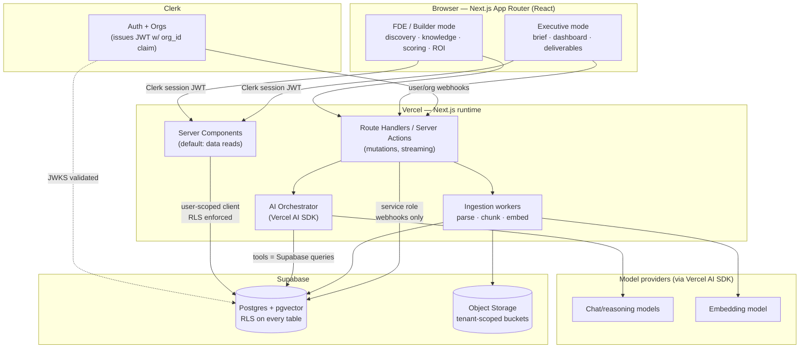
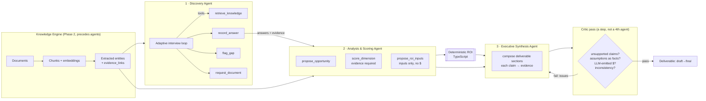
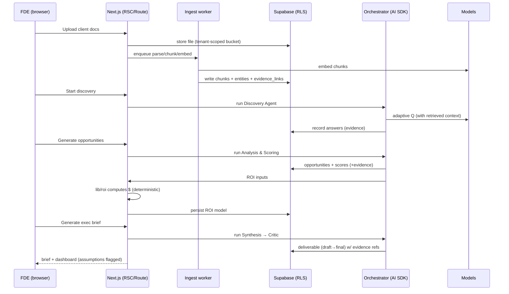

# Vedette — System Architecture (Phase 0)

> Status: **Phase 0 — Architecture & Decisions.** This document is the technical blueprint that Phase 1+ implements. It is authoritative for structure and data flow; where it conflicts with `CLAUDE.md`, **`CLAUDE.md` wins**. Companion artifacts: [`schema.sql`](schema.sql) (database + RLS), [`adr/`](adr/) (decision records 001–004), [`CHARTER.md`](CHARTER.md) (product vision), [`PHASES.md`](PHASES.md) (build order).

---

## 1. Design goals (what the architecture must guarantee)

These are load-bearing. Every structural choice below traces to one of them.

1. **Evidence or it didn't happen.** No score, entity, or deliverable claim is persisted or rendered without a link to its source (a document chunk or an interview answer). This is enforced at the data layer (schema + validation), not just in the UI. See `evidence_links` and the write-path validators.
2. **Assumptions are labeled, never laundered into facts.** Every score dimension and ROI input carries an `is_assumption` flag and a confidence value. The UI renders assumptions distinctly.
3. **LLMs propose, TypeScript computes money.** Models emit *inputs* (hours, frequency, loaded cost, adoption %). Deterministic, inspectable TypeScript produces every dollar figure. No model output path can emit a currency value into a deliverable.
4. **Multi-tenant from row zero.** Every domain row carries `organization_id`. RLS enforces isolation at the database, so a bug in application code cannot leak across tenants.
5. **Three agents, a critic, and a clear seam between them.** Discovery → Analysis & Scoring → Executive Synthesis, each a bounded step with typed inputs/outputs, a critic pass before anything ships. (ADR-004.)
6. **Dogfoodable.** An FDE must be able to drive the discovery tracker live during a client call. Latency and keyboard-drivability are architectural constraints, not polish.

---

## 2. System context



**Reading the diagram:** the browser only ever talks to the Next.js runtime. Data reads default to **Server Components** using a *user-scoped* Supabase client whose requests carry the Clerk JWT, so **RLS is the enforcement boundary**. The **service-role** client (which bypasses RLS) is confined to two trusted contexts: Clerk webhooks (syncing users/orgs) and background ingestion jobs. Client components never receive secrets and never hold a service-role key.

---

## 3. Layers

| Layer | Responsibility | Key tech | Notes |
|---|---|---|---|
| **Presentation** | Enterprise UI, dashboards, maps, editable-assumption panels | React, Tailwind, shadcn/ui, Recharts, React Flow | Server components by default; client components only for interactivity (forms, editable ROI, live agent stream). |
| **Application / API** | Route handlers, server actions, streaming endpoints | Next.js App Router | Mutations validated with Zod at the boundary. |
| **AI Orchestration** | Three agents + critic, tool execution, structured output | Vercel AI SDK, Zod | Plain-TS orchestrator (ADR-003). No LangGraph. |
| **Domain logic** | Deterministic ROI math, score normalization/weights, evidence validation | TypeScript (`lib/roi`, `lib/scoring`, `lib/evidence`) | Pure, unit-tested, no model calls. This is where dollars are computed. |
| **Data access** | Typed queries, RLS-scoped clients | Supabase JS client (ADR-001) | No ORM. `db/` holds typed query modules + generated types. |
| **Knowledge** | Chunking, embeddings, retrieval | pgvector, embedding model | Retrieval is a tool the agents call, not a hidden step. |
| **Auth / Tenancy** | Identity, orgs, session JWT | Clerk (ADR-002) → Supabase third-party auth | JWT `org_id` claim drives RLS. |
| **Storage** | Uploaded documents | Supabase Storage | Path convention `{organization_id}/{engagement_id}/{document_id}/…`, RLS-guarded. |

---

## 4. Tenancy & identity model

**Vocabulary.** A tenant is an **`organization`** (a consultancy *or* a self-serve enterprise account). Work happens inside an **`engagement`** — one assessment project. For a consultancy, each client is an engagement; for a self-serve enterprise, an engagement is a self-assessment (or one per business unit). **Meridian Field Services is a seeded *engagement*, not an organization.**

Every domain row carries **both** `organization_id` (the tenant/RLS boundary) and, where relevant, `engagement_id` (the work scope). Carrying `organization_id` on every table lets RLS policies be simple equality checks instead of multi-join lookups — a deliberate denormalization for correctness and speed.

**Clerk ↔ Supabase.** Clerk is the identity source and issues the session JWT. Supabase is configured with Clerk as a **third-party auth provider** and validates Clerk's JWT via JWKS. Clerk's session token is configured to include an `org_id` claim (`{{org.id}}`) and the user id in `sub`. RLS resolves the internal tenant UUID through a stable helper:

```sql
-- returns the internal organizations.id for the caller's active Clerk org
auth.org_id()  -- SECURITY DEFINER, STABLE; looks up organizations.clerk_org_id = jwt->>'org_id'
```

A Clerk webhook (`/api/webhooks/clerk`) keeps `organizations` and `users` mirrored (create/update/delete, membership role changes). The mirror exists so we can foreign-key to local rows and attach org-scoped profile/role data; Clerk remains the source of truth for authentication.

See [`schema.sql`](schema.sql) §RLS for the full policy set.

---

## 5. The three agents + critic (orchestration)

Per **ADR-004**, there are exactly three agents plus a critic pass. The specialist "roles" from the charter (Business Analyst, Process Intelligence, AI Solutions Architect, Automation, Security & Governance, ROI Analyst, Executive Communications, Implementation Planning) are **prompt perspectives** applied *inside* these three — not standing agents.



### 5.1 Agent contracts

| Agent | Input | Tools (thin wrappers over Supabase / domain logic) | Output (Zod-typed) | Invariant enforced |
|---|---|---|---|---|
| **Discovery** | engagement + ingested knowledge + prior answers | `retrieve_knowledge`, `record_answer`, `flag_gap`, `request_document`, `assess_coverage` | next question(s), coverage delta, gap list | Every recorded answer becomes an `answers` row → usable as evidence. Follow-ups must cite the knowledge that prompted them. |
| **Analysis & Scoring** | knowledge + answers + processes/systems/pain points | `retrieve_knowledge`, `propose_opportunity`, `score_dimension`, `propose_roi_inputs` | opportunities, per-dimension scores + rationale, ROI **inputs** | `score_dimension` **rejects** a score with no `evidence_links` unless `is_assumption=true`. `propose_roi_inputs` schema has **no currency field** — only hours/frequency/cost/adoption. |
| **Executive Synthesis** | scored opportunities + computed ROI + knowledge | `retrieve_knowledge`, `compose_section` | structured deliverable (sections, each with evidence refs) | Each section's claims must resolve to evidence ids; no free-floating assertions. |
| **Critic** (pass) | Synthesis (and Scoring) output | read-only validators | verdict `{pass|revise}` + issue list | Flags: claim-without-evidence, assumption-rendered-as-fact, any dollar value not produced by the ROI calculator, internal contradiction. One revise loop, then human review. |

### 5.2 Orchestration mechanics (Vercel AI SDK)

- **Agent loops** (Discovery) use `streamText` / `generateText` with `tools` and a bounded `stopWhen`/step cap; the human FDE stays in the loop for the live interview.
- **Structured extraction, scoring, synthesis** use `generateObject` with **Zod** schemas (`lib/ai/schemas`). Validation happens at the tool/output boundary, so the model is forced to retry on malformed output.
- **The orchestrator** (`lib/ai/orchestrator.ts`) is ordinary TypeScript that sequences the agents per engagement stage and persists results. No graph framework (ADR-003).
- **Tools** (`lib/ai/tools`) are the *only* way agents touch data; each is a small function running a user-scoped Supabase query or a domain-logic call. This keeps the evidence/assumption invariants in one place.
- **Deterministic seam:** ROI inputs proposed by the Analysis agent flow into `lib/roi` (pure TS) which computes savings/payback. The model never sees a "$" field to fill.
- **Observability:** every agent invocation is written to `agent_runs` (model, tokens, latency, critic verdict) for traceability and the accept/reject learning signal.

---

## 6. Core data flow (end to end)



---

## 7. Application folder structure

```text
vedette/
├─ CLAUDE.md                      # operating instructions (root, authoritative)
├─ README.md
├─ .env.example                   # names of required env vars, no values
├─ .github/workflows/ci.yml       # lint · typecheck · test (Phase 1)
├─ components.json                # shadcn/ui config
├─ next.config.ts
├─ tailwind.config.ts
├─ tsconfig.json
├─ docs/
│  ├─ CHARTER.md
│  ├─ PHASES.md
│  ├─ architecture.md             # this file
│  ├─ schema.sql                  # DB schema + RLS (source of truth for data model)
│  └─ adr/ADR-001..004.md
├─ supabase/
│  ├─ migrations/                 # ordered SQL migrations (derived from schema.sql)
│  ├─ seed/                       # Meridian Field Services seed (Phase 1) — one command
│  └─ config.toml
├─ public/
├─ src/
│  ├─ app/
│  │  ├─ (marketing)/             # public landing (Phase 6)
│  │  ├─ (app)/                   # authenticated shell
│  │  │  ├─ layout.tsx            # nav shell, org switcher
│  │  │  ├─ dashboard/
│  │  │  ├─ engagements/[engagementId]/
│  │  │  │  ├─ knowledge/         # document library + entity browser (Phase 2)
│  │  │  │  ├─ discovery/         # interview tracker + Discovery agent (Phase 3)
│  │  │  │  ├─ opportunities/     # backlog, scoring, ROI, matrix (Phase 4)
│  │  │  │  └─ deliverables/      # exec brief + PDF export (Phase 5)
│  │  │  └─ settings/
│  │  └─ api/
│  │     ├─ webhooks/clerk/       # user/org sync → service-role client
│  │     ├─ ingest/               # parse/chunk/embed jobs
│  │     └─ agents/               # streaming agent run endpoints
│  ├─ components/                 # shadcn ui, charts (Recharts), maps (React Flow)
│  ├─ lib/
│  │  ├─ supabase/                # server.ts · client.ts · service.ts (three clients)
│  │  ├─ auth/                    # Clerk helpers, org resolution
│  │  ├─ ai/
│  │  │  ├─ orchestrator.ts       # sequences the three agents + critic
│  │  │  ├─ agents/               # discovery.ts · analysis.ts · synthesis.ts · critic.ts
│  │  │  ├─ tools/                # retrieve_knowledge, record_answer, score_dimension, …
│  │  │  └─ schemas/              # Zod schemas for every structured output
│  │  ├─ roi/                     # deterministic ROI calculators (pure TS, tested)
│  │  ├─ scoring/                 # dimension normalization + weights (pure TS, tested)
│  │  └─ evidence/                # write-path evidence/assumption validators
│  ├─ db/                         # typed query modules + generated Supabase types
│  └─ types/
└─ tests/                         # scoring math, ROI math, ingestion, RLS policy tests
```

**Rule of thumb the tree encodes:** anything that produces a number a client sees lives in `lib/roi` or `lib/scoring` (pure, tested TypeScript). Anything that talks to a model lives under `lib/ai`. The two only meet at the orchestrator, where model-proposed inputs cross into deterministic computation.

---

## 8. Security posture (summary; full policies in schema.sql)

- **RLS on every table**, default-deny. Tenant isolation via `organization_id = auth.org_id()`; writes additionally gated by role (`owner`/`admin`/`member` write, `viewer` read-only).
- **Three Supabase clients:** (1) *server user-scoped* (carries Clerk JWT, RLS-enforced — the default for all reads/writes on behalf of a user); (2) *browser* (anon key, RLS-enforced, no secrets); (3) *service-role* (bypasses RLS — used **only** in Clerk webhooks and ingestion jobs, never reachable from the client).
- **No client-side secrets.** Model provider keys and the service-role key are server-only env vars.
- **Storage** objects are tenant-pathed and policy-guarded to `auth.org_id()`.
- **Prompt-injection hygiene:** ingested document content is *data*, never instructions. Agent tools that mutate data validate the tenant/engagement scope server-side; the LLM cannot widen scope by asking.
- **Evidence integrity:** the write path (`lib/evidence`) rejects scores/claims lacking evidence unless explicitly flagged as assumptions — a code-level invariant, backed by not-null/`check` constraints where feasible.

---

## 9. What Phase 0 intentionally leaves open

Carried into the summary and open-questions handoff (not decided here): embedding model/provider choice and vector dimension; ROI default constants (loaded-cost bands, adoption ramp shape); exact Clerk JWT claim wiring for `org_id`; whether `agent_runs`/`roi_models` (supporting tables below the 16 required) stay as-is or get folded. These are flagged in the session summary and belong to Phase 1 kickoff.
